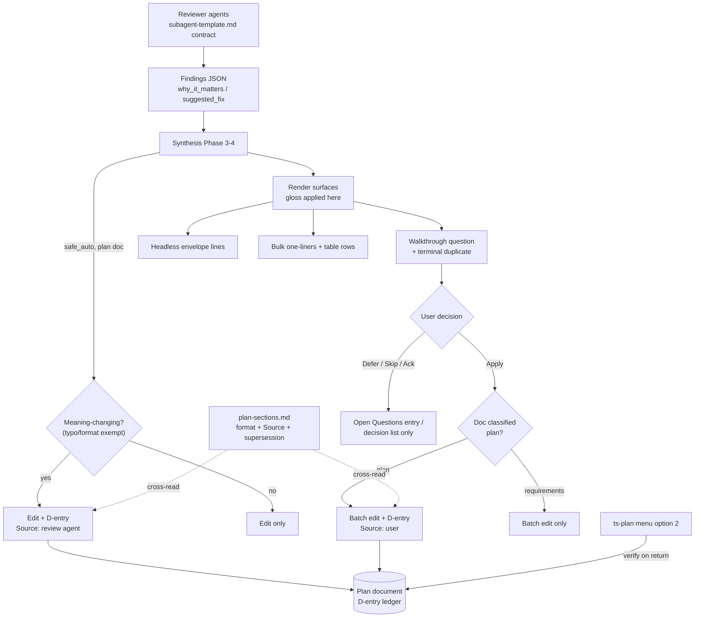
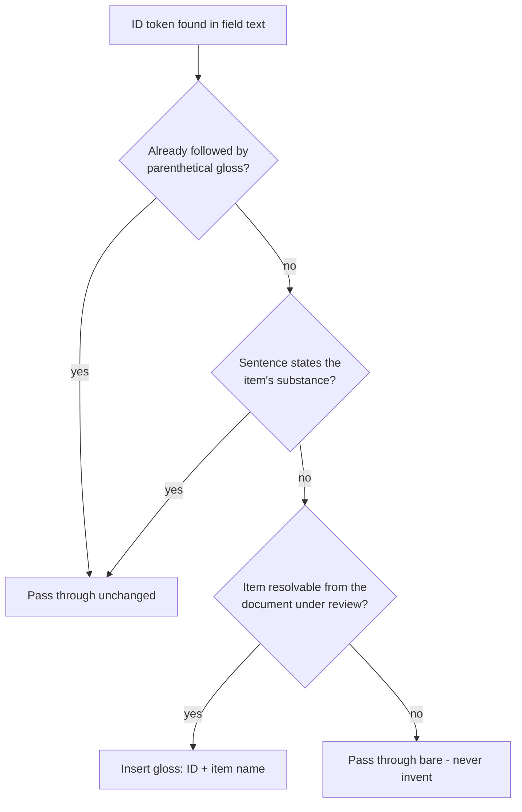

# fix: ts-doc-review render gloss and D-entry emission (#227, #228)

## Summary

Close the two ts-doc-review failings filed from a real plan-review run: plan-item IDs reaching the user unglossed (#227), and plan edits landing without D-entries so decision rationale survives only in chat (#228). Both fixes defer to the section contract in `skills/ts-plan/references/plan-sections.md` — glossed references and the decision-log format — which stays the single owner and becomes the declared shared contract ts-doc-review cross-reads.

---

## Problem Frame

A ts-plan run on 2026-11-24 ended with a headless doc-review pass and a six-finding interactive walkthrough. Two structural gaps surfaced:

1. **Gloss dropped at render time (#227).** The walkthrough's "render `why_it_matters` as-is" substitution passes bare plan-item IDs (`R3`, `U2 step 4`, `KTD5`) through to question text, the headless envelope, and bulk-preview one-liners. Nothing in the render path requires glossing, so the reader must round-trip to the plan — the exact failure the glossed-references rule in `skills/ts-plan/references/plan-sections.md` exists to prevent.
2. **Decisions never reach the document (#228).** Walkthrough Apply decisions and meaning-changing `safe_auto` fixes edited the plan with zero D-entries. The decision-log JSONL is deleted after a successful run, leaving the chat transcript as the only record. A later tightening pass can legitimately strip a user-approved constraint because the approval behind it is nowhere in the document — the cascade the D-entry contract exists to stop.

Root cause shared by both: ts-doc-review never reads ts-plan's section contract, and its render/execution instructions contain no rule binding them to it. The issues' proposed changes are the operative spec; the retrofit origin doc (`docs/plans/ts-audhd-retrofit-instructions.md`, changes C2 and C7) supplies intent and sequencing context — where the two disagree with the live files, the files win (stop-on-drift rule).

---

## Requirements

**Render-time gloss (#227)**

- R1. A finding whose `why_it_matters` contains a bare plan-item ID (`R#`, `U#`, `KTD#`, `F#`, `AE#`, scoped D-entry IDs, composite tokens like `U2 step 4`) renders in the walkthrough question — including the terminal duplicate and dependent-list lines — with a parenthetical gloss naming the item, or with a sentence that already states the item's substance.
- R2. The same guarantee holds in the headless envelope finding lines, the bulk-preview per-finding one-liners, and the review-output-template table rows.
- R3. The walkthrough's "render `why_it_matters` as-is" instruction explicitly defers to the gloss rule for ID tokens.
- R4. Reviewer agents carry a gloss-on-first-use instruction for `why_it_matters` and `suggested_fix` in their operating contract; the findings schema gains no new field.

**D-entry emission (#228)**

- R5. A walkthrough Apply on a plan-classified document emits a D-entry into its governing section in the same batch pass, with Source naming the user decision and the originating reviewer in the context phrase.
- R6. A meaning-changing `safe_auto` fix on a plan-classified document emits a D-entry with `review agent <Name>` Source — in interactive and headless modes alike.
- R7. The bulk-preview Proceed path behaves identically to the walkthrough path.
- R8. Requirements-classified documents are unaffected: edits land, no D-entries are written, the report omits the D-entry line.
- R9. Later rounds superseding an earlier decision follow the plan-sections strike-through and Status handling; `Source: user` protection transfers to the replacement.
- R10. The unified completion report lists the count and scoped IDs of emitted D-entries, omitted when zero.
- R11. ts-plan's post-generation menu option 2 verifies on return that every D-entry obligation the completion report claims is present in the document, and reports the check's result in the re-rendered menu summary line.

---

## Key Technical Decisions

- KTD1. **Canonical gloss rule lives once, in the walkthrough's Substitutions block; the other render surfaces cross-reference it.** Four copies of the rule would drift; the issue's own structure centralizes it where substitution rules already live.
- KTD2. **Render-side glossing fires only on un-glossed tokens.** Source-side (reviewer contract) and render-side rules run together; without an idempotence test the same ID acquires two divergent glosses.
- KTD3. **The D-entry format is cross-read from `skills/ts-plan/references/plan-sections.md` via a `${CLAUDE_PLUGIN_ROOT}`-anchored sibling path with a guarded visible fallback; that file stays owner and gains a consumer-declaration line.** User-directed at scoping (two rounds: shared-file proposal revised to owner-as-shared-contract). Duplication drifts; a bare or CWD-relative path breaks in the plugin cache.
- KTD4. **Emission gates on the Phase 1 document classification (`plan`), consulted once at batch start — no re-classification.** Classification is content-shape-based and settled at Phase 1; re-deriving it at execution time invites divergence between the gate and the primer.
- KTD5. **Apply edits and meaning-changing `safe_auto` fixes emit D-entries; Defer's durable record is its Open Questions entry; Skip and Acknowledge stay in the decision list and completion report.** Reconciles the plan-sections trigger ("every user decision") with #228's Apply-set scope — defers are staged items, not content constraints. Recorded at the cross-read site so the two contracts never read as contradictory.
- KTD6. **Source values per path: walkthrough Apply logs `user` with the reviewer named in the context phrase; bulk-path approval logs `user` with a batch-level context phrase; `safe_auto` logs `review agent <Name>`. Dates come from `date +%F` at emission, never inferred.** The plan-sections Source list is closed; naming who decided keeps the ledger auditable.
- KTD7. **A D-entry's section prefix derives from the heading or unit ID where the edit landed, not from the finding's `section` string.** `section` is free text; scoped IDs must match the document's real structure.
- KTD8. **Headless mode emits D-entries too, and the envelope's applied-fix lines carry the emitted IDs as a suffix.** The Phase 4 apply pass is shared across modes; `skills/ts-plan/references/plan-handoff.md` step 5.3.8 captures counts loosely, so the suffix is safe — and it gives the option-2 verification a signal.
- KTD9. **The reviewer contract gains a ledger-suppression rule: D-entry existence, format, placement, and provenance are not findings; content findings stay in scope, and any finding that would change, remove, or contradict a `Source: user` entry names that conflict explicitly.** Without it, round-2 reviewers flag the ledger this fix just wrote.
- KTD10. **No new validation tooling — verification extends the existing suites and baselines only.** User-confirmed at scoping; the mechanical cross-read existence check is deferred (see Scope Boundaries), flagged rather than silently dropped.

---

## High-Level Technical Design

**In short:** one gloss rule applied at the render boundary of four render surfaces, and one emission rule applied at the two document-write passes, both anchored to the plan-sections contract.

The gloss decision procedure every render surface runs per ID token:

---

## Implementation Units

### U1. Render-time gloss rule across the four render surfaces

- **Goal:** Every plan-item ID reaching the user through any ts-doc-review output carries an in-place gloss (or an equivalent substance-stating sentence).
- **Requirements:** R1 (walkthrough question gloss), R2 (envelope and bulk one-liners), R3 (as-is deferral).
- **Dependencies:** none.
- **Files:**
  - `skills/ts-doc-review/references/walkthrough.md` (canonical rule)
  - `skills/ts-doc-review/references/synthesis-and-presentation.md` (headless envelope + interactive lines)
  - `skills/ts-doc-review/references/bulk-preview.md` (per-finding one-liners; routing-question list lines inherit)
  - `skills/ts-doc-review/references/review-output-template.md` (table row cells)
- **Approach:** Add a gloss substitution bullet to the Substitutions block in walkthrough.md's "Per-finding presentation" section, stating the canonical rule: any plan-item ID in question text, the terminal duplicate, or dependent-list lines carries a parenthetical gloss sourced from the document under review (held in orchestrator context from the Phase 1 read); the substance-sentence exception applies; the ID-token decision procedure follows the second HTD diagram. Amend the `What's wrong:` "rendered as-is" substitution with one carve-out sentence: as-is rendering does not exempt ID tokens — gloss bare IDs at render time before the question fires. The gloss lands at question-assembly time, so the terminal duplicate mirrors the glossed question and the duplicates-rewrite-nothing rule in `docs/solutions/developer-experience/self-contained-blocking-questions-skill-walkthroughs.md` sees no divergence. Cross-reference (do not restate) the canonical rule from the envelope finding lines in synthesis-and-presentation.md, the bulk-preview per-finding line format, and the review-output-template row-writing rule. Bulk one-liners gloss IDs in the first sentence, and the tight paraphrase used to fit the preview width preserves glossed ID tokens — re-gloss after fitting when the paraphrase drops one — so a width-fitted line never loses its gloss. Completion-report finding lines reuse the glossed `why_it_matters` snippet (same rule, no separate wording).
- **Patterns to follow:** The existing Substitutions bullets (label — rule — rationale clause of ≤25 words); the "Plain language" bullet is the nearest precedent for first-use explanation.
- **Test scenarios:**
  - `why_it_matters` reading `R4's hygiene commitment is stale` on a plan whose R4 (explicit version tag) exists renders as `R4 (explicit version tag)'s hygiene commitment is stale` in the question.
  - Field text already carrying `U2 step 4 (smoke test list)` passes through with no second gloss (idempotence).
  - `KTD5's own bootstrap chown/repair` — sentence states substance — needs no added gloss.
  - An `F#` token with no resolvable item in the document renders bare; no invented gloss.
  - Headless envelope `Why:` line and bulk one-liner both show the gloss; the width-fitted or tightly paraphrased one-liner still carries the gloss.
  - A requirements-classified document (no U-/KTD-IDs) still fires on R-/F-/AE- tokens — glossed where the item resolves, bare where it does not; only U-/KTD- tokens are absent.
  - No heading renames: "Per-finding presentation" is cited by name in four places; this unit adds bullets inside it and renames nothing.
- **Verification:** Inspection of the four files against issue #227's acceptance checklist.

### U2. Reviewer-contract gloss instruction and D-entry ledger suppression

- **Goal:** Reviewer agents gloss plan-item IDs at the source, and no reviewer flags the decision ledger itself.
- **Requirements:** R4 (source-side instruction); supports R1–R3 (frequency reduction).
- **Dependencies:** none (lands before or with U3 (D-entry emission) so round-2 reviewers see the suppression rule as soon as the ledger exists).
- **Files:** `skills/ts-doc-review/references/subagent-template.md`
- **Approach:** In the `why_it_matters` writing-guidance region, add: gloss plan-item IDs on first use, same parenthetical form and substance-sentence exception as the render rule; the instruction rides field semantics — schema unchanged. Add a Rules-list bullet near the `suggested_fix` rules extending the same to `suggested_fix`. Add an exclusion bullet alongside the existing `## Deferred / Open Questions` exclusion: D-entry blocks are this workflow's decision ledger — do not flag their existence, format, placement, or provenance; content findings stay fully in scope; any finding that would change, remove, or contradict a `Source: user` D-entry names that conflict explicitly. That last clause mirrors the plan-sections cross-reference flag — it adds visibility, not the C5 classification guard, which stays deferred (see Scope Boundaries). Per `docs/solutions/conventions/subagent-bootstrap-dispatch.md`, reviewers read this contract from disk at dispatch, so the instruction reaches every agent without touching the nine role prompts.
- **Patterns to follow:** Existing Rules-list bullets (imperative + ≤25-word rationale clause); the existing exclusion region's phrasing.
- **Test scenarios:**
  - The template block remains a valid fenced template; the bootstrap read-list is unchanged (file set, order).
  - Every added rule carries a one-sentence rationale (retrofit convention, spot-checkable).
  - The suppression bullet is unconditional (not gated on round number), so round 1 on a plan already carrying D-entries is covered.
- **Verification:** Inspection; no schema diff (`skills/ts-doc-review/references/findings-schema.json` untouched).

### U3. D-entry emission in the execution passes

- **Goal:** Plan-classified documents receive D-entries for walkthrough Applies and meaning-changing `safe_auto` fixes, written in the same pass as the edits.
- **Requirements:** R5 (Apply emission), R6 (safe_auto emission, both modes), R7 (bulk parity), R8 (requirements untouched), R9 (supersession), R10 (completion report).
- **Dependencies:** U2 (ledger suppression) before or with this unit.
- **Files:**
  - `skills/ts-doc-review/references/walkthrough.md` (end-of-walk-through execution, execution posture, cross-read instruction)
  - `skills/ts-doc-review/references/synthesis-and-presentation.md` (Phase 4 safe_auto apply, envelope annotation, cross-read instruction)
  - `skills/ts-doc-review/references/bulk-preview.md` (Proceed semantics inheritance sentence)
  - `skills/ts-plan/references/plan-sections.md` (consumer-declaration line only)
- **Approach:** In walkthrough.md's "End-of-walk-through execution": consult the Phase 1 classification once at batch start (KTD4); for each Apply-set edit, after the edit lands, emit the D-entry — prefix from the governing heading or unit ID in the document (KTD7), sequence from a scan of the section's live D-entry headings, Source values per path (KTD6), date via `date +%F`. Extend the re-read-before-write mandate to the batch pass (mirrors `skills/ts-doc-review/references/open-questions-defer.md`). Failure paths: a failed edit goes to the failure section with no D-entry and the batch continues; a D-entry write that fails after its edit landed retries in-pass, and a persistent failure gets a prominent report — an unlogged landed edit is the exact cascade #228 stops. The report's D-entry count equals landed edits, never Apply-set size, and the line is omitted at zero (covers the all-Defer and all-Skip terminals and the zero-findings degenerate case, whose summary line extends the same way). Supersession: a batch-time scan of live D-entries; an Apply contradicting an existing entry supersedes it per plan-sections — struck heading, Status line first, full scoped ID — and `Source: user` entries supersede only through a user Apply, protection transferring to the replacement. Plan-sections' KTD obligations carry over: plan-wide decisions log in the KTD section with glossed pointers in affected units; a D-entry changing a KTD updates the KTD text and adds the glossed amendment pointer. In synthesis-and-presentation.md's Phase 4 safe_auto apply: after each applied fix on a plan-classified document, judge meaning-changing against the plan-sections trigger — typo, spelling, and formatting exempt; wrong counts, added content, retargeted cross-references, and terminology drift qualify — and emit the D-entry with `review agent <Name>` Source in the same pass, identically in headless mode (KTD8); the envelope's applied-fix lines carry the emitted IDs. In bulk-preview.md's Proceed semantics: one sentence making emission inheritance from walkthrough.md's batching rules explicit, with the batch-level approval context phrase (KTD6). In walkthrough.md's "Execution posture": fold D-entry emission into the batch-edit clause (not a fifth write surface), and correct the pre-existing omission of the Phase 4 safe_auto edits from the permitted-writes list. The cross-read instruction (placed with the emission rule in both files): read the D-entry and glossed-references contracts from `${CLAUDE_PLUGIN_ROOT}/skills/ts-plan/references/plan-sections.md`, guarded fallback with a visible error per the plugin path-resolution rule; record the Defer/Skip/Acknowledge carve-out (KTD5) here. In plan-sections.md's Decision log section: one declaration line — ts-doc-review's walkthrough and safe_auto passes consume this contract; changes here propagate to both skills.
- **Patterns to follow:** The D-entry worked example in plan-sections.md; the decision primer's structured-context mechanics; open-questions-defer.md's re-read-before-write discipline.
- **Execution note:** Characterization first — run `tests/scripts/test_extract_ktds.py` green before editing to lock the extractor's D-entry-heading baseline; the suite exercises the extractor on inline fixtures and reads neither prose file, so the end-of-walk-through and Phase 4 regions verify by inspection, with extractor coverage of emitted D-entry shapes coming from the fixture scenario below.
- **Test scenarios:**
  - `tests/scripts/test_extract_ktds.py`: D-entries written into a KTD section in the emitted shape (including a superseded struck-through entry) parse without extractor changes; add a fixture only if walkthrough-shaped entries are uncovered.
  - Requirements-classified document: edits land, zero D-entries, report omits the line (R8).
  - Interrupted walkthrough (decision log partial, no batch pass): no document edits, no D-entries — correctly absent.
  - Edit fails mid-batch: failure section records it, no D-entry for it, batch completes remaining edits.
  - D-entry write fails after its edit landed: in-pass retry; persistent failure surfaces in the report's failure section, never silently skipped.
  - Second-round walkthrough: sequence numbering continues from the section's live entries; a contradicting Apply supersedes with strike-through and Status (R9).
  - Headless run on a plan doc: safe_auto meaning-changing fixes emit `review agent <Name>` entries; envelope applied-fix lines carry the IDs (R6).
  - Bulk Proceed on a plan-classified document emits the same D-entries and report lines as the walkthrough path (R7).
  - An all-Defer or all-Skip terminal run omits the report's D-entry line (R10).
- **Verification:** `tests/scripts/test_extract_ktds.py` green (run per U5); inspection against issue #228's acceptance checklist, including the bulk-preview Proceed parity item (R7).

### U4. ts-plan handoff verification on doc-review return

- **Goal:** The post-generation menu's deeper-review option verifies the ledger landed and reports the result.
- **Requirements:** R11 (option-2 verification and summary-line report).
- **Dependencies:** U3 (D-entry emission) — verifies what it emits.
- **Files:** `skills/ts-plan/references/plan-handoff.md`
- **Approach:** Extend the option-2 bullet: on return, verify every D-entry obligation the completion report claims is present in the document by scanning the D-entry headings — worded against obligations claimed, not "every walkthrough decision" (Skip, Defer, and Acknowledge legitimately have none; the issue's phrasing over-reads). On a gap: name it in the re-rendered menu summary line and offer repair — ts-plan holds the Why in the session transcript and appends the missing entry with the user's consent. At the same bullet, correct the false R29 claim: the headless pass records no decisions, so nothing suppresses across that invocation boundary; with D-entries in the document and R30's evidence-overlap check, landed fixes are visible to the fresh round through the document itself. This mirrors ts-plan SKILL.md Phase 0.1's end-of-session verify rule, closing the loop the issue names.
- **Patterns to follow:** The summary-line mechanism already specified for the menu (one concise line above it); Phase 0.1's same-pass verify phrasing.
- **Test scenarios:**
  - Option 2 returns after a walkthrough that emitted three D-entries: the re-rendered summary line reports the verified count.
  - A claimed-but-missing entry (simulated) is named in the summary line and repair is offered, not auto-applied.
  - Step 5.3.8's envelope capture still reads the applied-fixes count correctly with the U3 ID suffixes present (counts are captured loosely — tolerant by construction).
- **Verification:** Inspection; the 5.3.8 capture tolerance confirmed against the envelope-capture bullet in the same file.

### U5. Verification pass: suites, baselines, conformance

- **Goal:** The change set passes the repo's existing gates with no script or baseline drift.
- **Requirements:** Supports R1–R11 (verification backbone).
- **Dependencies:** U1–U4.
- **Files:**
  - `tests/scripts/test_extract_ktds.py` (run; extend fixture only per U3's scenario)
  - `tests/baselines/word-counts.txt`, `tests/baselines/file-hashes.txt` (refresh via the existing capture script)
- **Approach:** Run the pytest suites, `scripts/run-test-suites.sh`, and `scripts/verify-script-refs.sh`. The new cross-read mentions are markdown references, not script invocations — confirm the gate stays green (it scans for unguarded script paths only). Refresh the manual baselines via `tests/baselines/capture-baselines.sh`: the hash capture covers four of the seven edited files (subagent-template.md, synthesis-and-presentation.md, plan-sections.md, plan-handoff.md), the word-count capture the first two; walkthrough.md, bulk-preview.md, and review-output-template.md are captured by no baseline. Global.D4 check: no script consumes the edited regions except the KTD extractor, covered above.
- **Test expectation:** existing suites only — this unit adds no new harness (KTD10).
- **Verification:** All named suites green; `git diff --stat` over `tests/baselines/` shows only expected capture refreshes.

---

## Scope Boundaries

Non-goals for this plan:

- No findings-schema change — #227's acceptance criteria forbid a new field.
- No C5 constraint-guard classification (the safe_auto-vs-`Source: user` guard from the retrofit doc) — retrofit PR 2 owns it; see Risks for the interim visibility measure.
- No C8 conversational-rules installation beyond what the issues themselves specify.
- No changes to ts-plan SKILL.md's 5.3.8 machinery (retrofit B4 freeze holds).
- No new validation tooling (user-confirmed; KTD10).

### Deferred to Follow-Up Work

- C5 constraint-guard slice: classification-time check that a finding touching a `Source: user` D-entry is never `safe_auto` (retrofit PR 2 scope).
- Mechanical cross-read existence check: a gate asserting the cross-read target section exists in `skills/ts-plan/references/plan-sections.md` — new tooling, out of confirmed scope; flagged per the gate-pairing rule in `docs/solutions/tooling-decisions/compliance-gate-scope-classification.md` rather than silently dropped.
- Live-model render verification — the headless gloss run against a small plan containing bare-ID findings, plus retrofit D7's template-compliance five-check run (deferred until the separate template-bug fix lands).
- Remaining retrofit Part C items (C1, C3, C4, C8) per the retrofit doc's PR sequencing.
- Post-landing: capture the D-entry emission pattern as a solutions doc — `docs/solutions/` currently has no D-entry learning (the gap is itself signal).

---

## Risks & Dependencies

- **Dependency: PR 1 must be the base.** The D-entry and gloss contracts this plan cross-reads live in `skills/ts-plan/references/plan-sections.md` as landed on `feat/audhd-retrofit-pr1`; this work branches after that merges (retrofit sequencing: Part C after Part B).
- **Risk: C5 gap.** Until the deferred guard lands, a `safe_auto` fix can still silently contradict a `Source: user` entry — the ledger records the violation but nothing prevents it. Interim: U2's suppression bullet forces any finding touching a `Source: user` entry to name the conflict explicitly (visibility, not prevention).
- **Risk: first-of-kind cross-skill read.** No skill today reads another skill's reference file; no gate validates the target exists. Mitigations: the consumer-declaration line in plan-sections.md, the guarded visible fallback, and the U5 inspection.
- **Risk: retrofit drift.** The retrofit doc's C7 text names an Edit-option the current menu does not have; this plan follows the issues' Apply-set formulation — the live files win (stop-on-drift). If later Part C work lands with different structure, U3's emission wording is the reconciliation point.
- **Risk: D-entry volume.** Most `safe_auto` fixes on plan docs are meaning-changing, so the ledger grows fast. Accepted: entries are one sentence plus metadata; typo-class fixes stay exempt.

---

## Sources & Research

- Issues #227 and #228 (GitHub, open) — operative spec and acceptance criteria.
- `docs/plans/ts-audhd-retrofit-instructions.md` — origin context: C2 (findings carry meaning), C7 (walkthrough writes D-entries), global rules (stop-on-drift, neutral language, Global.D4 script/test coupling, ≤25-word rationale clauses), PR sequencing.
- `skills/ts-plan/references/plan-sections.md` — normative contracts: "Decision log (D-entries)" (trigger, format, Source closed list, supersession, KTD relationship) and "Glossed references".
- `docs/solutions/developer-experience/self-contained-blocking-questions-skill-walkthroughs.md` — question-text self-containment precedent; the duplicates-rewrite-nothing rule U1's assembly-time gloss honors.
- `docs/solutions/tooling-decisions/claude-code-plugin-script-path-resolution.md` — sibling-path anchoring and guarded fallback for the cross-read.
- `docs/solutions/conventions/subagent-bootstrap-dispatch.md` — why the source-side gloss instruction must live in the reviewer contract file.
- `docs/solutions/tooling-decisions/compliance-gate-scope-classification.md` — gate-pairing rule; why the deferred mechanical check is flagged, not dropped.
- Local research confirmed: no cross-skill reference-file read exists yet; `scripts/verify-script-refs.sh` covers script invocations only; `tests/baselines/` captures four of the edited files (excluded from CI; manual refresh); `scripts/extract-ktds.py` already absorbs D-entry headings.
