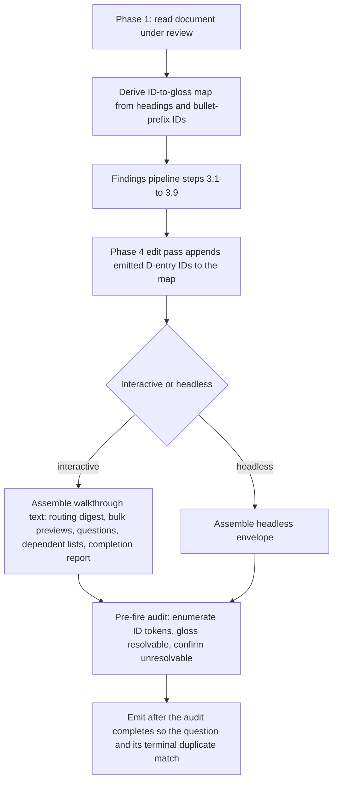

## Summary

Implement issues #234 and #233 together. #234 (section order): plan documents render Scope Boundaries, Risks & Dependencies, Open Questions, and Assumptions immediately after Key Technical Decisions, and render Implementation Units — with High-Level Technical Design immediately before it — after Documentation / Operational Notes and before Sources & Research; the order rule is owned by the rendering reference and adopted by every ts-plan creation path and by ts-doc-review fixes that create these sections. #233 (gloss consistency): ts-doc-review glosses plan-item IDs consistently across every user-facing surface via a tightened exemption, a once-per-round ID-to-gloss map, and a named pre-fire audit over assembled text. All changes are instruction prose; no runtime code, no schema changes.

---

## Problem Frame

Issue #234: plan documents bury their most decision-forcing sections at the back. Scope Boundaries and Risks & Dependencies render after Implementation Units — the part of the document the user demonstrably does not reach before acting on the plan. This has repeatedly let unagreed content slip into approved plans unnoticed; the sections that force scope and risk decisions are the ones most likely to be skipped. The requested fix is positional: move them into the front half, before Implementation Units.

Issue #233: during a real doc-review run (2026-11-25) the gloss rule was applied inconsistently across the two user-facing surfaces — the headless findings envelope and the per-finding walkthrough questions. Bare IDs reached the user in finding titles and body lines (`U2 — baseline word-budget gate skipped`, `R5 conformance has no verification step`). Root cause: the gloss rule lives inside substitution prose with no assembly-time check, the sentence-states-substance exemption was stretched from full sentences to title fragments, and the per-token procedure was never run over the assembled text.

The user's stated rationale for both: cut the work needed to understand plan boundaries and risks, and provide a consistent interface. Both issue bodies state the problem (justification satisfied).

---

## Requirements

**Plan rendering order (from #234)**

- R1. Plan documents render Scope Boundaries, Risks & Dependencies, Open Questions, and Assumptions — whenever present — immediately after Key Technical Decisions, in that relative order.
- R2. High-Level Technical Design renders immediately before Implementation Units; Implementation Units render after Documentation / Operational Notes and before Sources & Research; all other sections keep their current relative order; no section's inclusion criteria change.
- R3. Omitted sections are skipped with no placeholder position, and no front-block section ever renders below Implementation Units.
- R4. Sections newly created by any ts-plan path — initial generation, deepening passes, resume and edit sessions — place per the same order rule.

**Doc-review fix placement (from #234)**

- R5. ts-doc-review fixes that create content in these sections insert the section per the order rule, never relocate an existing section, and no reviewer finding flags a legacy plan's late placement.

**Gloss consistency (from #233)**

- R6. The sentence-states-substance exemption holds only when the item's function is named in the same clause as the ID token; title lines and heading lines always gloss.
- R7. A named pre-fire audit runs over every user-facing text surface rendered from the findings set before it fires: each ID token enumerated, resolvable bare tokens glossed, remaining bare tokens confirmed unresolvable.
- R8. An ID-to-gloss map, derived from the document under review at Phase 1 and re-derived each review round, is a required input to the walkthrough and the headless envelope, extended mid-run with D-entry IDs emitted by applied fixes.

**Verification**

- R9. Instruction-prose changes verify via the repo's dry-run pattern; existing suites stay green.

---

## Key Technical Decisions

- KTD-1 [literal]. The placement rule is stated once in `skills/ts-plan/references/markdown-rendering.md` as a "Section order" subsection, and the catalogs whose listing order carries de-facto ordering (`plan-sections.md` include-when-material list, `SKILL.md` Phase 4.2 summary) are reordered to match with a one-line pointer, not a restatement. Rationale: `plan-sections.md`'s own header disclaims page presentation, so restating the rule there creates a second drifting copy — the anti-pattern recorded for the gloss rule. Deviates from the issue's named file; the issue's requirement is met by the pointer plus matching listing order.
- KTD-2 [literal]. Full render order: Summary → Problem Frame → Requirements → Key Technical Decisions → Scope Boundaries → Risks & Dependencies → Open Questions → Assumptions → System-Wide Impact → Acceptance Examples → Documentation / Operational Notes → High-Level Technical Design → Implementation Units → Sources & Research. Omitted sections skip without placeholders; the front block (Scope Boundaries, Risks & Dependencies, Open Questions, Assumptions) anchors after Key Technical Decisions, or after the last present section among Requirements, Problem Frame, and Summary when Key Technical Decisions is absent. Rationale: subset-invariant — which sections exist never changes where present ones sit; extends #234's required pair per KTD2.D1 (Open Questions in front block); Implementation Units position amended by KTD2.D2 (units to the back).
- KTD-3 [literal]. Assumptions joins the section catalog and the front block. Rationale: existing flows create `## Assumptions` (non-interactive synthesis routing) but it was never cataloged; a total order rule leaves it nowhere to sit, and it is decision-forcing content of exactly the kind #234 front-loads.
- KTD-4 [behavioral]. Legacy discipline: newly created sections place per the order rule regardless of document vintage; existing sections are never relocated, so in a legacy plan adjacency yields to no-relocation — a created Scope Boundaries may sit far from the document's late Risks & Dependencies; no reviewer finding flags late placement. Rationale: one unconditional rule beats vintage-sniffing; mixed-order legacy documents are an accepted transient state per KTD4.D1 (no migration finding).
- KTD-5 [literal]. The tightened exemption replaces the sentence-states-substance branch of the per-token procedure in place. Rationale: replace-not-stack precedent — a tightened rule stacked beside the old branch leaves the stretched reading live one paragraph away.
- KTD-6 [behavioral]. The pre-fire audit is defined once beside the canonical gloss rule in `walkthrough.md` and covers every surface rendered from the findings set — routing-question digest lines, bulk-preview one-liners, per-finding questions, dependent-list lines, completion-report lines, and the headless envelope — with other files cross-referencing it. It glosses resolvable bare tokens (one self-healing pass) and passes unresolvable tokens bare, and completes before the question and its terminal duplicate render. Rationale: extends the issue's two named files to every findings-rendering surface — otherwise audit coverage becomes a function of routing choice, recreating the inconsistency #233 fixes.
- KTD-7 [literal]. The ID-to-gloss map derives at Phase 1 by scanning the document under review — level-2 to level-4 headings (U-IDs, KTD items, D-entry IDs, section names) and bullet-prefix IDs (`R#`, `KTD#`, `F#`, `AE#`, `A#`) — and travels as orchestrator context to the walkthrough Entry and the envelope, never as a `findings-schema.json` field; composite tokens resolve via parent ID; re-derived each review round; extended after the edit pass with emitted D-entry IDs. Rationale: heading-only derivation would default-empty on requirements-classified documents, where every R-ID is a bullet prefix — the map must cover every token class the gloss rule enumerates.
- KTD-8 [behavioral]. The placement rule binds placement only; it never authorizes section creation. Rationale: removes the apparent conflict with the review rule against adding undiscussed sections; creation stays governed by existing fix-scope rules.

#### KTD2.D1. Open Questions joins the front block

**Decision:** Open Questions renders in the front block, after Risks & Dependencies and before High-Level Technical Design — extending #234's required pair.

**Why:** #234 leaves front-block composition open beyond the two required sections; the user chose to front-load the question-bearing section as well, while High-Level Technical Design stays adjacent to Implementation Units.

**Source:** user, 2026-11-26 scope synthesis — "Also front-load Open Questions"

#### KTD2.D2. Implementation Units renders at the back, before Sources & Research

**Decision:** Implementation Units renders after Documentation / Operational Notes and before Sources & Research; High-Level Technical Design stays immediately before it. The front block is unchanged.

**Why:** User correction — the long implementation detail belongs at the end of the decision-forcing reading order, so every section the user must read to understand boundaries and risks (scope, risks, questions, impact, examples, notes) precedes it.

**Source:** user, 2026-11-26 plan review — "the sequence for 'Implementation Units' needs to be after 'Documentation/Examples' and before 'Sources & Research'"

#### KTD4.D1. No legacy-plan migration finding

**Decision:** ts-doc-review gains no finding that flags legacy plans whose sections sit late; existing sections are never relocated during fixes.

**Why:** The user declined the migration path #234 marked "consider" — the new order applies to new plans only.

**Source:** user, 2026-11-26 scope synthesis — "No — new plans only"

#### KTD7.D1. All four #233 proposals implemented

**Decision:** #233 implements all four ranked proposals, including the map as a contract change to the walkthrough Entry and envelope inputs.

**Why:** The user confirmed the full set over the lighter audit-only subset.

**Source:** user, 2026-11-26 scope synthesis — "All four proposals"

---

## Scope Boundaries

- No inclusion-criteria changes for any section — #234 is positional only.
- No relocation or migration of already-written plans (KTD4.D1 (no migration finding)).
- No consolidation of the gloss rule's plan-side statements (`plan-sections.md` "Glossed references", ts-plan Conversational Output rule) into one canonical source — #233 marks it possible follow-up work.
- The pending three-word "states the problem" qualifier edit in ts-plan Phase 5.1 (a recorded loose end from #232) is untouched.
- ts-brainstorm's `markdown-rendering.md` copy and requirements-document ordering are untouched — different artifact catalog.
- No `findings-schema.json` change (KTD-7 (map as orchestrator context)).
- No new automated tests for prompt-text assets; dry-run scenarios are the check, per repo precedent.
- No baseline or word-count work (Scope.D1 (baselines excluded)).

#### Scope.D1. Baseline handling excluded

**Decision:** The plan does not touch `tests/baselines/` hash or word-count baselines; touched files drift and are refreshed manually outside this plan.

**Why:** Standing user ruling from the #232 plan — the refresh is manual tooling excluded from CI, so omitting it breaks no gate.

**Source:** user, 2026-11-25 doc-review ruling — "Remove anything dealing with them, they're out of scope" (applied to this plan's scope)

### Deferred to Follow-Up Work

- ts-compound capture of the section-ordering change after implementation — no `docs/solutions/` learning covers section placement, and the readable-plans retrofit (PR #225) is likewise uncaptured.
- Consider extending baseline coverage to the currently un-baselined instruction files (`walkthrough.md`, `bulk-preview.md`, `review-output-template.md`, `markdown-rendering.md`, `open-questions-defer.md`) — separate tooling decision.

---

## Risks & Dependencies

- Cross-skill contract propagation: `plan-sections.md` is cross-read by ts-doc-review via its consumer declaration, and `markdown-rendering.md` gains a consumer declaration in U1 (section-order rule) — edits propagate knowingly, but a failed cross-read degrades fix placement silently. Mitigation: guarded visible fallback per the established cross-read pattern.
- Mixed-order legacy documents: a review-created front section in a legacy plan produces temporarily mixed ordering (accepted consequence of KTD-4 (legacy discipline)).
- Un-baselined drift: most #233 targets (`walkthrough.md`, `bulk-preview.md`, `review-output-template.md`) and `markdown-rendering.md` carry no baseline — only dry-run verification catches regressions there.
- Baselined files drift when U2 through U6 land (`plan-sections.md`, both `SKILL.md`s, `deepening-workflow.md`, `synthesis-and-presentation.md`, `subagent-template.md`); refresh is manual and outside this plan (Scope.D1 (baselines excluded)).
- The audit's self-healing pass is bounded to one application — the canonical rule's existing idempotence clause (render fires only on un-glossed tokens) prevents loops; a second application would double-gloss.
- Sequencing: U1 (section-order rule) lands before U2 and U3 branch from it; U4 (canonical gloss rule and map) lands before U5 and U6 consume it.

#### Risks.D1. Sequencing bullet corrected to match unit cards

**Decision:** The sequencing bullet names only U2 (catalog and creation paths) and U3 (fix placement) as branching from U1; U4 (canonical gloss rule and map) and its dependents are independent of U1.

**Why:** The bullet claimed a U1-before-U4 edge the unit dependency cards omit (U4 declares no dependencies); the unit cards are the authoritative per-unit declarations.

**Source:** review agent coherence, 2026-11-26 headless doc review

---

## System-Wide Impact

- `plan-sections.md` is a cross-skill contract: ts-doc-review declares consumption of the D-entry contract there — the catalog reorder propagates knowingly to its walk-through and `safe_auto` passes.
- `markdown-rendering.md` (ts-plan's copy) gains a consumer declaration for ts-doc-review in U1 (section-order rule) — a new cross-skill coupling and the first cross-read of the rendering reference.
- Reviewer agents read `subagent-template.md` at dispatch — the exclusion extension in U3 (fix placement) changes what every reviewer treats as document content versus prior-round output.
- No runtime code, schemas (`findings-schema.json` unchanged), or scripts change; `open-questions-defer.md` needs no edit — its staging mechanics are position-free and its staging heading ("Deferred / Open Questions") does not collide with a plan's front-loaded "Open Questions" section.

#### System-Wide Impact.D1. Open-questions-defer entry edit on review (PR #236)

**Decision:** `open-questions-defer.md` gained one review-driven edit — its Step 4 dedup key now computes from the same post-gloss entry text the append writes (commit 121b37d, finding F5). The "needs no edit" claim above was scoped to section-order staging mechanics, which remain position-free and unchanged.

**Why:** Step 3 glosses `{title}` and `{why_it_matters}` before the append lands, so a key computed from raw schema fields mismatches keys parsed from existing rendered bullets whenever a field carries a glossed ID token — the collision check would miss an entry that is already present.

**Source:** PR #236 CodeRabbit review finding F5 (user-confirmed disposition: fix), 2026-11-26.

---

## High-Level Technical Design

**Section order, current de-facto versus new.** Each row is one section, listed in the new order, with the position it holds today — observed rendering practice across `docs/plans/`, carried by the include-when-material catalog listing; the hard-floor list does not carry ordering — and the position the new rule assigns:

| Section | Current | New |
|---|---|---|
| Summary | 1 | 1 |
| Problem Frame | 2 | 2 |
| Requirements | 3 | 3 |
| Key Technical Decisions | 4 | 4 |
| Scope Boundaries | 7 | 5 |
| Risks & Dependencies | 10 | 6 |
| Open Questions | 8 | 7 |
| Assumptions | — | 8 |
| System-Wide Impact | 9 | 9 |
| Acceptance Examples | 11 | 10 |
| Documentation / Operational Notes | 12 | 11 |
| High-Level Technical Design | 5 | 12 |
| Implementation Units | 6 | 13 |
| Sources & Research | 13 | 14 |

#### HTD.D1. Order table restructured one-row-per-section

**Decision:** The before/after comparison renders one row per section with its current and new positions (Implementation Units: 6 → 13), replacing the position-keyed layout where each section name appeared once per column; the caption now attributes the Current column to observed rendering practice across `docs/plans/`, not to the catalog listing read as a whole.

**Why:** The position-keyed layout read as if Implementation Units still sat at #6 — the Current column legitimately carried it there, and the user misread the updated table as unchanged during plan review; the caption's catalog attribution fed the same misread.

**Source:** user, 2026-11-26 plan review — "it's still showing Implementation Units at #6"

**Review-round gloss pipeline.** The map and audit attach to the existing doc-review pipeline without adding a findings-pipeline step — glossing stays a render-time concern:

---

## Implementation Units

### U1. Section-order rule in the rendering reference

**Goal:** One authoritative statement of plan-section rendering order, in the file that owns rendering.

**Requirements:** R1 (front-block placement), R2 (adjacency and unchanged relative order), R3 (skip-absent rule)

**Dependencies:** none

**Files:** `skills/ts-plan/references/markdown-rendering.md`

**Approach:** Add a "Section order (plan documents)" subsection after "Section anatomy": the full ordered list (Summary, Problem Frame, Requirements, Key Technical Decisions, then Scope Boundaries, Risks & Dependencies, Open Questions, Assumptions, then System-Wide Impact, Acceptance Examples, Documentation / Operational Notes, then High-Level Technical Design, Implementation Units, then Sources & Research), the skip-absent rule, the anchor rule, and the never-below-Implementation-Units clause, all per KTD-2 (full render order). Reorder the "Section anatomy" bullet list to match and remove its Implementation-Units-before-Key-Technical-Decisions contradiction. Add the consumer-declaration line for ts-doc-review per the cross-read pattern.

**Patterns to follow:** the consumer declaration on the D-entry contract in `plan-sections.md`; the "Post-write audit" subsection shape in the same file.

**Test scenarios:** Test expectation: none — prompt-text asset; no repo gate asserts rendering order. Dry-run verification lands in U7 (verification rounds).

**Verification:** fixture plan renders place sections per the rule in three cases: all sections present; front block partially present; Key Technical Decisions absent (front block anchors after Requirements).

### U2. ts-plan adopts the order across catalogs and creation paths

**Goal:** Every ts-plan path that lists or creates sections conforms to the order rule.

**Requirements:** R1 (front-block placement), R4 (creation paths place per rule)

**Dependencies:** U1 (section-order rule)

**Files:** `skills/ts-plan/references/plan-sections.md`, `skills/ts-plan/SKILL.md`, `skills/ts-plan/references/deepening-workflow.md`

**Approach:** Reorder the include-when-material listing to the render order (Scope Boundaries, Risks & Dependencies, Open Questions, Assumptions, System-Wide Impact, Acceptance Examples, Documentation / Operational Notes, High-Level Technical Design, Sources & Research). Add the Assumptions catalog bullet per KTD-3 (Assumptions cataloged): include in non-interactive plans carrying unvalidated bets; omit in interactive plans where synthesis validated the bets. Add the one-line rendering-order pointer to `markdown-rendering.md`'s rule. Update the `SKILL.md` Phase 4.2 catalog summary enumeration to match. Add placement sentences to the deepening checklist area (sections added during a deepening pass place per the order rule) and to Phase 0.1 resume editing (sections created during resume sessions place per the order rule).

**Patterns to follow:** existing "Include when material" bullet shape for the Assumptions entry; the #232 gate's single-sentence edit discipline in `SKILL.md`.

**Test scenarios:** Test expectation: none — prompt-text assets. Dry-run verification lands in U7 (verification rounds).

**Verification:** catalog listing order matches the U1 rule exactly; a deepening simulation adds Risks & Dependencies to a plan lacking it in the front-block position, not appended at document end; a resume simulation creates Scope Boundaries per the rule.

### U3. ts-doc-review fix placement and own-output exclusion

**Goal:** Review fixes that create front-block sections place them per the order rule; review-created sections are excluded from the next round as own output.

**Requirements:** R5 (fix placement, no relocation, no migration finding)

**Dependencies:** U1 (section-order rule, cross-read)

**Files:** `skills/ts-doc-review/references/walkthrough.md`, `skills/ts-doc-review/references/subagent-template.md`

**Approach:** In the fix-application pass instructions: fixes creating Scope Boundaries, Risks & Dependencies, Open Questions, or Assumptions content insert the section per the cross-read order rule (plugin-root-anchored path with guarded visible fallback); existing sections are never relocated; the rule binds placement only and never authorizes creation, per KTD-8 (placement binds, not creation). In `subagent-template.md`, extend the staging-exclusion list so sections ts-doc-review created in a prior round are excluded as own output, mirroring the existing D-entry ledger suppression clause.

**Patterns to follow:** existing cross-reads of `plan-sections.md` in `walkthrough.md` and `synthesis-and-presentation.md`; the D-entry ledger suppression clause in `subagent-template.md`.

**Test scenarios:** Test expectation: none — prompt-text assets. Dry-run verification lands in U7 (verification rounds).

**Verification:** legacy-plan simulation — a fix creating Scope Boundaries inserts after Key Technical Decisions without splitting the Implementation Units block, the document's late Risks & Dependencies stays put, and no finding fires for its late position; round-2 reviewer simulation treats a review-created Open Questions section as own output and does not quote it as evidence.

#### U3.D1. Review-created-section exclusion keeps substantive content in scope (PR #236)

**Decision:** The U3 staging-exclusion extension was rescoped by review (commit 121b37d, finding F3): a review-created section is excluded only as to existence, placement, and format — its substantive content stays fully in review scope and may be quoted as evidence, exactly as for D-entry blocks. This supersedes this unit's Verification sentence "does not quote it as evidence".

**Why:** The original wording contradicted the reviewer contract's mandatory-quote requirement and made defects inside review-created sections unreportable; the rescoped form mirrors the existing D-entry ledger suppression clause, which also keeps content findings fully in scope.

**Source:** PR #236 CodeRabbit review finding F3 (user-confirmed disposition: fix), 2026-11-26.

### U4. Canonical gloss rule: tightened exemption and ID-to-gloss map

**Goal:** The per-token gloss procedure is unambiguous at assembly time and resolves from a map built once per review round.

**Requirements:** R6 (tightened exemption), R8 (map input and derivation)

**Dependencies:** none

**Files:** `skills/ts-doc-review/references/walkthrough.md`, `skills/ts-doc-review/SKILL.md`

**Approach:** In the canonical rule's per-token procedure, replace the sentence-states-substance branch with the tightened form per KTD-5 (replace in place): valid only when the item's function is named in the same clause as the token; title lines and heading lines always gloss, no exemption. Name the map as the resolution source ahead of the held document, never inventing a gloss. Add the map to the walkthrough Entry list as a required input with its provenance (derived at Phase 1 per `SKILL.md`). In `SKILL.md` Phase 1, add the derivation step per KTD-7 (map derivation): scan level-2 to level-4 headings and bullet-prefix IDs (`R#`, `KTD#`, `F#`, `AE#`, `A#`); composite tokens resolve via parent ID; re-derive each review round.

**Patterns to follow:** the Entry list's existing three-item shape; the never-invent clause of the canonical rule.

**Test scenarios:** Test expectation: none — prompt-text assets. Dry-run verification lands in U7 (verification rounds).

**Verification:** gloss-decision fixtures: same-clause substance passes without gloss; a bare ID in a title line glosses (the stretched reading no longer passes); a requirements-classified document yields a non-empty map; a token absent from the map but resolvable in the held document resolves from the document, and an unresolvable token passes bare.

### U5. Pre-fire audit at every findings-rendering surface

**Goal:** Assembled user-facing review text is audited for ID glosses before it fires, on every surface.

**Requirements:** R7 (pre-fire audit across surfaces)

**Dependencies:** U4 (canonical gloss rule and map)

**Files:** `skills/ts-doc-review/references/walkthrough.md`, `skills/ts-doc-review/references/bulk-preview.md`, `skills/ts-doc-review/references/review-output-template.md`

**Approach:** Add a "Pre-fire audit" subsection beside the canonical gloss rule in `walkthrough.md`, defined once per KTD-6 (audit shape): before emitting any text rendered from the findings set — routing-question digest lines, bulk-preview one-liners, per-finding questions, dependent-list lines, completion-report lines — enumerate every ID token, gloss resolvable bare tokens in one self-healing pass, and confirm remaining bare tokens are unresolvable-class; the audit completes before the question and its terminal duplicate render, so the duplicate mirrors glossed text. State mode applicability: walkthrough surfaces audit in interactive runs; the envelope audits in headless runs (U6 (envelope side)). In `bulk-preview.md` and `review-output-template.md`, extend the existing gloss-rule cross-reference to name the audit — applies it, does not restate it.

**Patterns to follow:** the "Post-write audit" subsection shape in `skills/ts-plan/references/markdown-rendering.md`; the one-rule-plus-cross-references structure recorded in `docs/solutions/architecture-patterns/doc-review-gloss-rule-dentry-emission.md`.

**Test scenarios:** Test expectation: none — prompt-text assets. Dry-run verification lands in U7 (verification rounds).

**Verification:** fixture findings carrying bare IDs in a title line, a bulk-preview one-liner, and a routing digest line — each glosses before emission; an unresolvable token passes bare with no invented gloss; question and terminal duplicate match after the audit.

### U6. Headless envelope: map input, audit, and template example

**Goal:** The headless envelope consumes the map, runs the same audit, and its template normalizes glossed IDs.

**Requirements:** R7 (pre-fire audit), R8 (map input and mid-run extension)

**Dependencies:** U4 (canonical gloss rule and map), U5 (audit definition)

**Files:** `skills/ts-doc-review/references/synthesis-and-presentation.md`

**Approach:** State the map as a required input to envelope assembly, same provenance as the walkthrough Entry. Add the pre-fire audit to envelope emission (headless mode), cross-referencing the canonical definition. Add the mid-run extension: after the Phase 4 edit pass and before assembly, append D-entry scoped IDs emitted by applied fixes to the map. Add one glossed-ID example line to the envelope template's "Why:" example, per #233 proposal 4, so the rendered shape carries the rule. Note per-round map re-derivation for round-2 envelopes.

**Patterns to follow:** the existing gloss-rule cross-reference line in the same file ("this envelope applies the rule, it does not restate it").

**Test scenarios:** Test expectation: none — prompt-text asset. Dry-run verification lands in U7 (verification rounds).

**Verification:** headless simulation — a bare KTD ID in an envelope "Why:" line glosses before emission; an applied-fix line citing a D-entry ID emitted mid-run resolves from the extended map; the template example line carries a glossed ID.

### U7. Verification rounds

**Goal:** Dry-run scenarios prove the changed behavior; existing suites stay green.

**Requirements:** R9 (dry-run verification, suites green)

**Dependencies:** U1 (section-order rule), U2 (catalog and creation paths), U3 (fix placement), U4 (gloss rule and map), U5 (pre-fire audit), U6 (envelope)

**Files:** no source files; suites via `scripts/run-test-suites.sh` and `scripts/verify-script-refs.sh`

**Approach:** Run each unit's dry-run scenarios as written above (rendered fixture plans for U1 and U2; legacy-plan and round-2 simulations for U3; gloss-decision fixtures for U4; emission-audit fixtures for U5 and U6), then the suites. Add nothing to `tests/baselines/` per Scope.D1 (baselines excluded).

**Test scenarios:** Test expectation: none — this unit's content is the verification itself.

**Verification:** all dry-run scenarios pass as written; `scripts/run-test-suites.sh` and `scripts/verify-script-refs.sh` exit clean; the KTD-extraction pytest suite passes, confirming `scripts/extract-ktds.py` is unaffected by the reordering.

---

## Sources & Research

- Issues #233 and #234 — problem statements, ranked proposals, and affected-surface lists.
- `skills/ts-plan/references/plan-sections.md` — hard floor, include-when-material catalog, D-entry contract, prose-economy rules; the header disclaiming page-order jurisdiction.
- `skills/ts-plan/references/markdown-rendering.md` — "Section anatomy" (its listing contradicts the catalog order and lists Implementation Units before Key Technical Decisions), "Post-write audit" (the pattern the pre-fire audit mirrors).
- `skills/ts-doc-review/references/walkthrough.md` — Entry contract, canonical gloss rule and per-token procedure, fix-application pass.
- `skills/ts-doc-review/references/synthesis-and-presentation.md` — findings pipeline steps 3.1-3.9, headless envelope template and gloss wiring.
- `skills/ts-doc-review/references/open-questions-defer.md` — staging mechanics confirmed position-free.
- `docs/solutions/architecture-patterns/doc-review-gloss-rule-dentry-emission.md` — one-rule-plus-cross-references constraint; rejected four-per-surface approach.
- `docs/plans/2026-11-25-001-fix-ts-plan-justification-gate-plan.md` — dry-run verification pattern, prompt-text test-expectation convention, baseline-exclusion ruling.
- `scripts/extract-ktds.py` — heading-based KTD extraction, position-independent, unaffected by the reorder.
